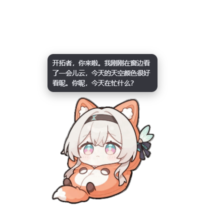

# dsh-firefly-pet

> 流萤桌宠 —— 住在 DeepSeek Harness 桌面上的透明置顶小窗。

**中文** | [English](#english)



## 它是什么

一个本地 DSH 插件：在桌面上开一个透明、置顶、无边框的小窗口，里面是流萤。
聊天走 **DSH 自己的模型服务**（`ctx.llm`），不需要填 API Key；人设读包内的
`assets/roleplay.md`。

## 功能

| 功能 | 说明 |
|---|---|
| **待机** | 常驻一张待机 GIF，可随时换 |
| **单击动作** | 随机播一个动作 GIF，播完回到待机（淡入淡出，不硬切） |
| **聊天** | 双击宠物（或右键「聊天」）打开输入框，回复以气泡流式显示；记忆持久化在 `~/.dsh/dsh-firefly-pet/memory.json` |
| **碎碎念** | 每 5 分钟自己说一句（46 条台词 + 模型润色），右键「说句话」可立即触发 |
| **任务播报** | 监听 DSH 会话事件：思考/调工具/任务清单/一轮结束，用一句短话播报；一轮结束会调一次模型润色。播报带会话标签，能看出是哪个对话框在干活 |
| **余额** | 右键「看余额」，走 DSH 账号服务（`deepseek-account`），不适合的服务商会明确提示 |
| **拖动/位置记忆** | 拖到哪下次就在哪；透明区域点击穿透，不挡桌面操作 |

## 安装

**DSH 桌面应用**：设置 → 插件 → 搜索 `dsh-firefly-pet` → 安装（装完重启应用）。

**命令行**：

```sh
dsh plugin --profile desktop add dsh-firefly-pet
```

需要 DSH Desktop 自带的 Electron 运行时（`~/.dsh/electron`）。找不到时桌宠不会出现，
日志里会有明确提示；可以先装 `dsh-pet` 之类的插件让它落一份，或设置环境变量
`FIREFLY_ELECTRON_PATH`。

## 配置

用户配置在 `~/.dsh/dsh-firefly-pet/config.json`（不存在则用包内默认值）：

```jsonc
{
  "gifDir": ".../assets/gifs",       // 素材目录，默认包内
  "gif": "流萤_狐狸_躺.gif",           // 启动时的待机图
  "size": 220,                        // 宠物边长(px)
  "marginX": 24, "marginY": 16,       // 默认距屏幕右下角的留白
  "roleplayPath": ".../assets/roleplay.md",
  "roleplayMaxChars": 20000,          // 人设截断上限
  "whisperEnabled": true,             // 碎碎念开关
  "whisperIntervalSec": 300,          // 碎碎念间隔
  "whisperPolish": true,              // 用模型润色台词（false = 0 成本直出）
  "whisperBubbleMs": 9000,            // 碎碎念气泡停留
  "chatModel": { "provider": "", "model": "" }  // 留空 = 跟随当前会话模型
}
```

### 素材池

两个 JSON 放在 `~/.dsh/dsh-firefly-pet/`，**不写就用包内默认**：

- `idle-gifs.json` —— 待机池，右键「换一只」只列这些
- `click-gifs.json` —— 动作池，单击随机播；支持给单张配时长：
  ```json
  [{ "file": "流萤_鼬_跳_x5_5s.gif", "ms": 5000 }, "流萤_小恐龙_喷火.gif"]
  ```

台词库在包内 `assets/whisper-lines.json`，可以直接替换。

## 已知限制

- **仅 Windows**：Electron 查找与窗口行为按 Windows 写的，macOS/Linux 未适配；
- 只支持桌面模式，没有网页 overlay 形态；
- 余额只支持 `deepseek-account`（无 API Key 的账号服务）；
- 任务播报只在「最后发过消息的那个会话」上工作，不是多会话聚合。

## 开发

```sh
dsh plugin --profile desktop add link:C:/path/to/dsh-firefly-pet   # 软链安装
dsh plugin --profile desktop remove dsh-firefly-pet                # 卸载
```

宿主半侧 `lib/index.js`（对话/播报/碎碎念/余额），桌面半侧
`runtime/helper/`（Electron 主进程 + 渲染端）。改宿主代码需要重新挂载插件；
只改 helper 则重启插件即可。

## English

A transparent, always-on-top desktop pet for DeepSeek Harness.

- **Chat** through the host's own model service (`ctx.llm`) — no API key needed;
  the persona lives in `assets/roleplay.md`.
- **Click** the pet to play a random action animation; **double-click** to chat.
- **Idle chatter** every 5 minutes (46 built-in lines, polished by the model),
  or trigger one from the right-click menu.
- **Task narration**: listens to `session/event` and says a short line for
  thinking / tool calls / todo updates / turn end, tagged with the session title.
- **Balance**: right-click → 看余额 (works with the `deepseek-account` provider).

Requires DSH Desktop (uses the shared Electron runtime at `~/.dsh/electron`).
Windows only for now.

## License

MIT. Bundled artwork is fan-made content for the character Firefly
(*Honkai: Star Rail*); rights belong to their respective owners.
